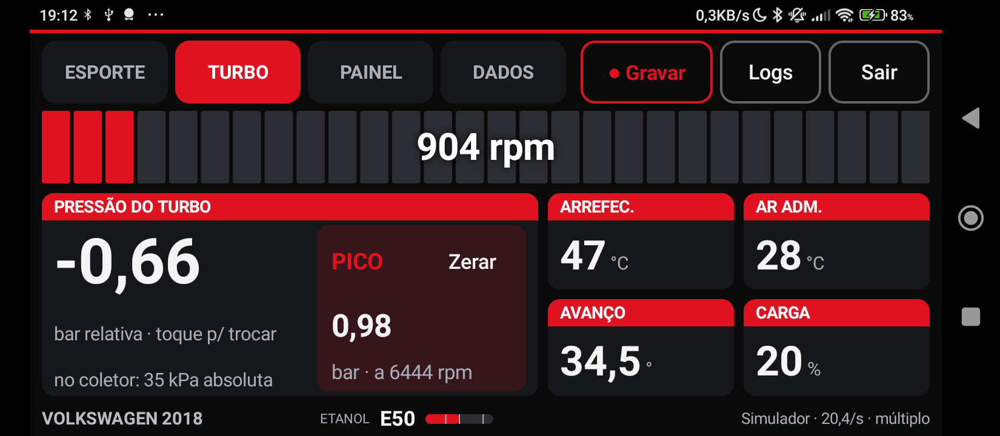
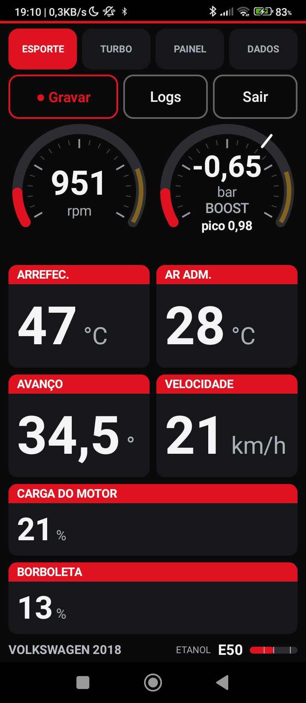
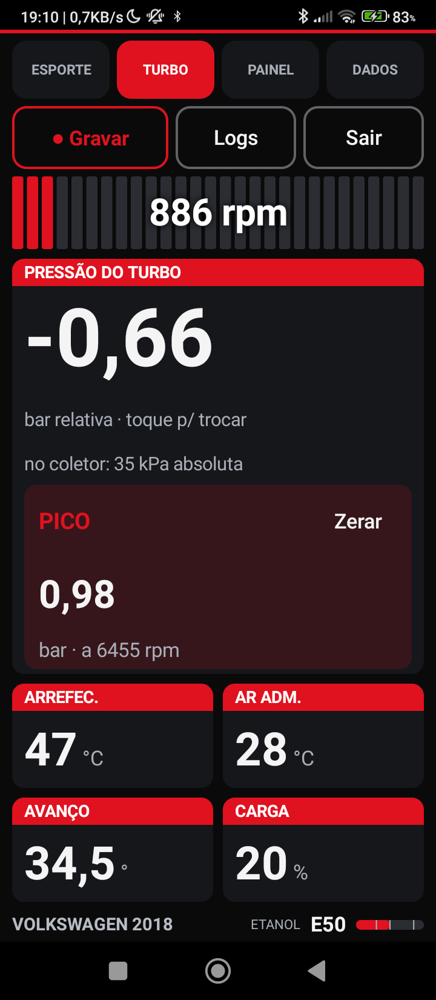
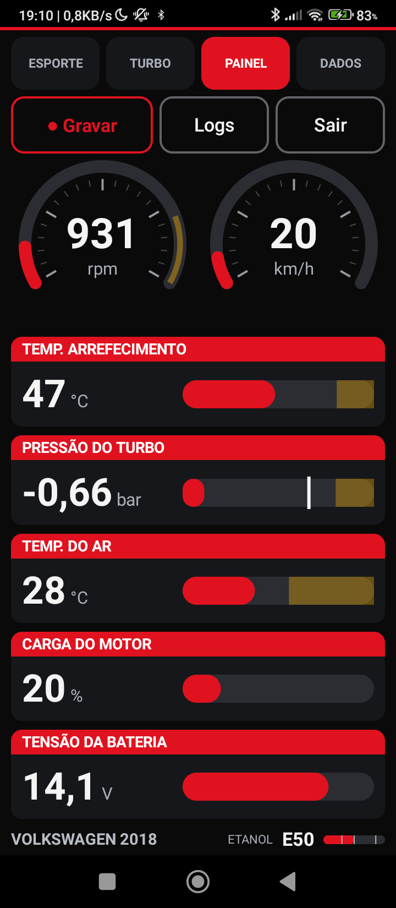
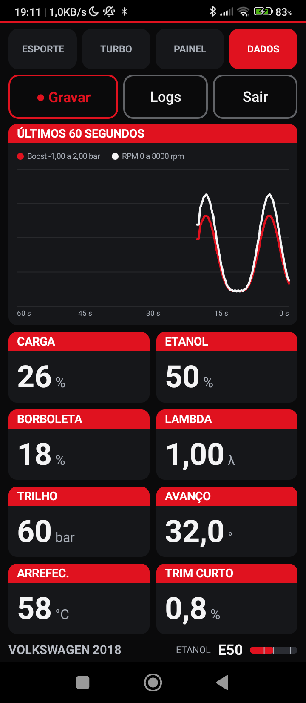
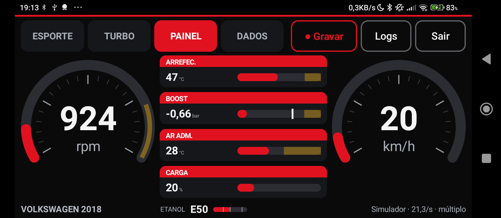
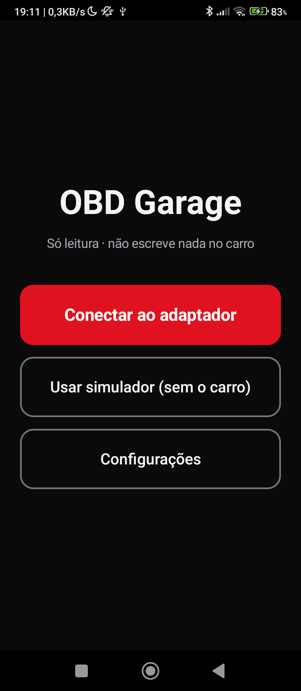
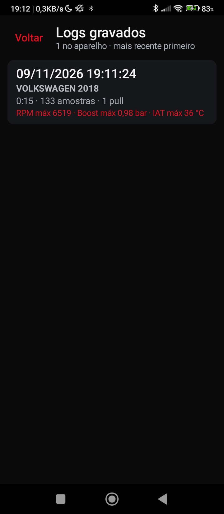

<div align="center">

# OBD Garage

**Painel digital para Android que lê o OBD-II do carro e mostra tudo em dashes grandes, feitos para ler de longe.**

Boost, RPM, temperaturas, teor de etanol e log de pulls, com o celular parado no painel.




</div>

---

## Sumário

- [Sobre](#sobre)
- [Telas](#telas)
- [O que tem](#o-que-tem)
- [Teor de etanol](#teor-de-etanol)
- [Log e pulls](#log-e-pulls)
- [Hardware compatível](#hardware-compatível)
- [Instalação](#instalação)
- [Como usar](#como-usar)
- [Segurança](#segurança)
- [Compilar](#compilar)
- [Estrutura do projeto](#estrutura-do-projeto)
- [Limitações e próximos passos](#limitações-e-próximos-passos)

---

## Sobre

OBD Garage é um app pessoal, feito por e para entusiastas: ele conversa com um adaptador **ELM327 Bluetooth LE**, lê os dados do motor pelo OBD-II padrão e mostra em dashes com letras grandes, botões de mais de 72 dp e cores do Golf GTI (preto, vermelho Tornado, cinza-aço). A ideia é olhar de relance, sem aproximar o celular.

Foi desenvolvido e testado em um **VW Polo TSI Highline 2018 (plataforma MQB)** com o adaptador **Vgate iCar Pro BLE**. Instalação por APK, sem Play Store.

## Telas

> Capturas feitas no modo simulador (sem carro), que imita um ELM327 com duas ECUs, como o Polo real.

| Esporte | Turbo | Painel | Dados |
|:---:|:---:|:---:|:---:|
|  |  |  |  |
| RPM e boost em gauges grandes, com cards de apoio | Barra de troca de marcha, pressão do turbo e pico | RPM e velocidade circulares, barras de apoio | Gráfico dos últimos 60 s e grade de parâmetros |

**Em paisagem** os mesmos dashes se reorganizam para aproveitar a largura:

| Turbo | Painel |
|:---:|:---:|
|  |  |

**Conexão e logs:**

| Tela inicial | Lista de logs |
|:---:|:---:|
|  |  |

## O que tem

### Quatro dashes

| Dash | Para quê |
|---|---|
| **Esporte** | Dois gauges grandes (RPM e boost) e cards de apoio: arrefecimento, óleo, ar de admissão, avanço, velocidade, carga. |
| **Turbo** | Barra de troca de marcha com o RPM dentro, **pressão do turbo** em destaque e bloco de **pico** com o RPM em que ocorreu e botão para zerar. |
| **Painel** | RPM e velocidade circulares nos cantos e barras horizontais no meio. |
| **Dados** | Gráfico ao vivo dos últimos 60 s e grade densa de parâmetros com barras. |

Os dashes só mostram o que o carro realmente informa.

### Pressão do turbo explicada

O número grande é a pressão **relativa** (quanto o turbo empurra acima da atmosfera). A pressão absoluta no coletor, a que o sensor MAP mede, aparece logo abaixo. A atmosfera usada na conta é a barométrica medida pela ECU (PID 33), que corrige altitude e clima. Tocando no valor, a unidade troca entre **bar, kgf/cm², psi e kPa**.

### Outros recursos

- **Carro turbo ou aspirado:** o app descobre sozinho (sem MAP, ou sem pressão positiva em plena carga, é aspirado) e esconde o que não faz sentido, como a aba de boost.
- **Nome do carro pelo VIN:** marca e ano pelo código do chassi; o nome é editável tocando no rodapé.
- **Leitura contínua:** um serviço em primeiro plano mantém a conexão com a tela apagada ou com outro app aberto.
- **Leitura rápida:** pede vários PIDs de uma vez (até 6 por requisição) e desce sozinho para o modo simples se o carro não aceitar. No Polo, atualiza os sensores rápidos a cerca de 2 a 3 vezes por segundo.
- **Configurações antes de conectar:** tema escuro, claro ou automático; unidade do boost; tamanho do texto (1,0 / 1,15 / 1,3); orientação; aba inicial; tela sempre ligada.
- **Modo simulador:** testa toda a interface sem carro nem adaptador.

## Teor de etanol

Para quem anda com E30, E50 ou outra mistura, saber o teor antes de puxar é essencial. O app lê o **PID 52** (teor de etanol no combustível) e mostra no **rodapé de todos os dashes**, de forma discreta:

```
ETANOL  E50  ▬▬▬▬▬|▬▬▬▬
```

- Nome da mistura (E32, E50...) e uma barra fina com marcas em **E30**, **E50** e **E85**.
- Só aparece se o carro informa o PID 52. O Polo informa.
- É a **estimativa da própria ECU**, que reavalia depois de abastecer. Rode alguns minutos antes de confiar no número e confira com um medidor quando for um log importante.
- O teor também é gravado em cada log (coluna `ethanol`).

## Log e pulls

- **Gravação** de sessões em CSV, com hora precisa, nome e nota, carro e VIN no cabeçalho.
- **Lista de logs** consultável, com o carro de cada sessão.
- **Detecção automática de pulls** (acelerações plenas) dentro de cada log.
- **Estatísticas** de mínimo e máximo de cada sensor, com o instante e o RPM em que ocorreram.
- **Gráfico estilo dinamômetro**, por RPM ou por tempo, usando só os dados que o OBD realmente entrega.
- Os arquivos ficam em `Android/data/com.walter.obdgarage/files/logs/` e abrem em qualquer planilha.

## Hardware compatível

| | |
|---|---|
| **Adaptador** | ELM327 **Bluetooth LE** (testado: Vgate iCar Pro BLE). Adaptadores Bluetooth clássico (SPP) e Wi-Fi não são suportados. |
| **Carro** | Qualquer carro com OBD-II/CAN deve funcionar; testado só no VW Polo TSI 2018. Os sensores disponíveis dependem do que cada ECU declara. |
| **Celular** | Android 8.0 (API 26) ou mais novo. Testado no POCO C40 (Android 11) e no Galaxy Z Fold 4. |

## Instalação

1. Baixe o APK mais recente em **[Releases](../../releases)**.
2. Copie para o celular e abra. Se o Android pedir, permita instalar de fontes desconhecidas.
3. Ligue o **Bluetooth** e a **localização** (o Android exige localização para buscar dispositivos BLE) e aceite as permissões quando o app pedir.

## Como usar

1. Encaixe o adaptador na porta OBD-II do carro e ligue a ignição.
2. Abra o app e toque em **Conectar ao adaptador**; escolha o seu na lista. Nas vezes seguintes aparece **Reconectar**.
3. O app inicializa o adaptador, descobre a ECU do motor e começa a mostrar os dados. Deslize entre os dashes ou toque nas abas.
4. Toque em **Gravar** para registrar uma sessão. Os logs ficam em **Logs gravados**, na tela inicial.

Sem carro por perto, use **Usar simulador (sem o carro)**.

## Segurança

- **O app só lê.** Ele envia apenas comandos `AT*` ao adaptador e pedidos do modo 01 (dados atuais), mais o VIN (modo 09). Qualquer outro comando é bloqueado no código. Nunca escreve nada no carro.
- O pino 16 da porta OBD-II tem **12 V sempre**: tire o adaptador se o carro ficar parado por dias, para não descarregar a bateria.
- Não opere o celular dirigindo. Configure com o carro parado e use o dash só de relance.

## Compilar

Requisitos: **JDK 17** e Android SDK (compileSdk 34). O JDK mais novo do Android Studio (25) quebra o Gradle 8.9; aponte o Gradle para o 17.

```powershell
$env:JAVA_HOME="C:\Program Files\Eclipse Adoptium\jdk-17.0.20.101-hotspot"
.\gradlew.bat testDebugUnitTest assembleDebug     # testes + APK de teste
.\gradlew.bat assembleRelease                     # APK assinado
```

Saída em `app/build/outputs/apk/<debug|release>/`.

**Stack:** Kotlin 2.0, Jetpack Compose (BOM 2024.09), Gradle 8.9, AGP 8.5.2, API nativa de Bluetooth LE (sem bibliotecas de terceiros para OBD).

### Assinatura do release

Crie um `keystore.properties` na raiz do projeto. Ele **não vai para o git**:

```properties
storeFile=C:/caminho/para/obd-garage-release.jks
storePassword=...
keyAlias=obdgarage
keyPassword=...
```

Sem o arquivo, o release sai sem assinar. **Guarde o `.jks` e as senhas em lugar seguro:** sem a mesma chave não dá para atualizar um app já instalado.

## Estrutura do projeto

```
app/src/main/java/com/walter/obdgarage/
├── obd/    protocolo ELM327, catálogo de sensores, agendador de leitura, simulador
├── ble/    busca e conexão Bluetooth LE
├── log/    gravação, CSV, detecção de pulls, estatísticas
└── ui/     dashes, gauges, telas e tema
app/src/test/   testes unitários (protocolo, leitura múltipla, agendador, log, unidades)
```

## Limitações e próximos passos

- Só lê o **OBD-II padrão (modo 01)**. A temperatura do óleo, por exemplo, não é declarada pelo motor do Polo; só virá por diagnóstico VAG/UDS, que ainda não foi implementado.
- Ainda não há layout de dashes configurável.
- Ideias futuras: leitura VAG/UDS (óleo, boost nominal x real), Android Auto, mais temas de cores.
